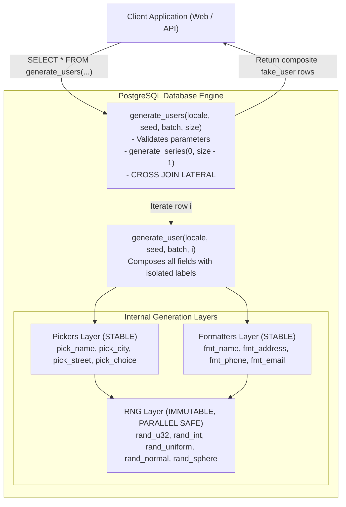

# Stored Procedures and Functions Reference: Faker in SQL

A complete and self-contained fake data generation library implemented entirely inside PostgreSQL stored routines.

All data generation logic is executed directly within the database engine. No application-level or client-side generation logic is used. Client applications (such as Python or Flask) simply issue standard SQL queries against these routines.

---

## Table of Contents

1. [Architecture and Design Philosophy](#1-architecture-and-design-philosophy)
2. [Quick Start: Using Faker in SQL](#2-quick-start-using-faker-in-sql)
3. [Mathematical and Algorithmic Foundations](#3-mathematical-and-algorithmic-foundations)
   - [3.1 Deterministic Pseudo-Random Generation (PRNG)](#31-deterministic-pseudo-random-generation-prng)
   - [3.2 Normally Distributed Values (Box-Muller Transform)](#32-normally-distributed-values-box-muller-transform)
   - [3.3 Geographic Coordinates with Constant Area PDF](#33-geographic-coordinates-with-constant-area-pdf)
   - [3.4 Weighted Categorical Sampling (Roulette Wheel)](#34-weighted-categorical-sampling-roulette-wheel)
   - [3.5 Customizable Name and Address Composition](#35-customizable-name-and-address-composition)
   - [3.6 Markov Chain Natural Text Synthesis](#36-markov-chain-natural-text-synthesis)
4. [Database Schema Diagram](#4-database-schema-diagram)
5. [Routine Reference: RNG Layer (010_rng.sql)](#5-routine-reference-rng-layer)
   - [rand_u32](#rand_u32)
   - [rand_int](#rand_int)
   - [rand_uniform](#rand_uniform)
   - [rand_normal](#rand_normal)
   - [rand_sphere](#rand_sphere)
6. [Routine Reference: Pickers Layer (020_pickers.sql)](#6-routine-reference-pickers-layer)
   - [pick_name](#pick_name)
   - [pick_city](#pick_city)
   - [pick_street](#pick_street)
   - [pick_choice](#pick_choice)
   - [get_body_params](#get_body_params)
7. [Routine Reference: Formatters Layer (030_formatters.sql)](#7-routine-reference-formatters-layer)
   - [apply_translit](#apply_translit)
   - [fmt_name](#fmt_name)
   - [fmt_address](#fmt_address)
   - [fmt_phone](#fmt_phone)
   - [fmt_email](#fmt_email)
8. [Routine Reference: Composer Layer (040_composer.sql)](#8-routine-reference-composer-layer)
   - [generate_user](#generate_user)
9. [Routine Reference: Public API Layer (050_api.sql)](#9-routine-reference-public-api-layer)
   - [list_locales](#list_locales)
   - [generate_users](#generate_users)
   - [generate_text](#generate_text)
10. [How to Add a New Locale](#10-how-to-add-a-new-locale)
11. [Immutability and Determinism Guarantees](#11-immutability-and-determinism-guarantees)

---

## 1. Architecture and Design Philosophy

Traditional fake-data generators run in memory on client application servers and insert generated rows one by one. This causes high network round-trip latency, high serialization overhead, and inability to join directly with existing database tables.

Faker in SQL moves the entire generator into PostgreSQL:
- Zero ORM and Zero Client Generation: The application issues a SELECT statement and receives structured, pre-formatted records.
- Pure Functional Determinism: A state vector $(s, \text{locale}, b, i, f)$ maps deterministically to an identical output row, regardless of query plan or call order.
- Set-Based Parallel Execution: Uses PostgreSQL generate_series and LATERAL subqueries, allowing the database query planner to vectorize and parallelize row composition.



---

## 2. Quick Start: Using Faker in SQL

Once SQL files are applied to your PostgreSQL database, all routines are instantly available to any SQL client:

### Generating a Batch of Users (Main API)
```sql
SELECT * FROM generate_users('en_US', 42, 0, 10)
```
```sql
SELECT * FROM generate_users('de_DE', 999, 5, 50)
```

### Seeding an Application Table Directly in SQL
```sql
INSERT INTO customers (full_name, email, phone, city, latitude, longitude)
SELECT 
    full_name,
    email,
    phone,
    split_part(address, ',', 2),
    latitude,
    longitude
FROM generate_series(0, 19) AS b(batch_no)
CROSS JOIN LATERAL generate_users('en_US', 12345, b.batch_no, 50)
```

### Generating Individual Attributes
```sql
SELECT * FROM generate_user('en_US', 42, 0, 0)
```
```sql
SELECT rand_normal(42, 'en_US', 0, 0, 'height', 178.0, 7.5)
```
```sql
SELECT * FROM rand_sphere(42, 'en_US', 0, 0, 'geo')
```
```sql
SELECT generate_text('de_DE', 42, 0, 0, 60)
```

---

## 3. Mathematical and Algorithmic Foundations

### 3.1 Deterministic Pseudo-Random Generation (PRNG)

#### The Problem with Native Database Randomness
PostgreSQL provides `random()` and `setseed()`. However:
1. `random()` is non-deterministic in concurrent sessions or set-based queries.
2. `setseed()` modifies connection-level state. If PostgreSQL parallelizes a query across background workers, state is desynchronized.
3. Subqueries or LATERAL joins re-evaluate rows unpredictably, breaking reproducibility.

#### The State-Vector Hash Engine
To achieve total determinism, `rand_u32` computes pseudo-random bits as a pure mathematical function of 5 parameters:

$$\text{Key} = \text{seed} \mathbin{\Vert} \text{":"} \mathbin{\Vert} \text{locale} \mathbin{\Vert} \text{":"} \mathbin{\Vert} \text{batch} \mathbin{\Vert} \text{":"} \mathbin{\Vert} i \mathbin{\Vert} \text{":"} \mathbin{\Vert} \text{field}$$

- Domain Separation via field: Every attribute has a distinct label (e.g. `'gender'`, `'first'`, `'height#1'`, `'phone#3'`). Even if two records share identical seed, batch, and index, independent attributes sample orthogonal hash spaces.
- Avalanche Effect: MD5 and SHA produce uniform diffusion. Changing a single bit in the seed or incrementing index $i$ flips approximately 50 percent of the output bits.
- Unsigned 32-Bit Conversion:
  $$\text{MD5}(\text{Key}) \longrightarrow \text{take first 8 hex characters} \longrightarrow \text{bit}(32)$$
  In PostgreSQL, `bit(32)::bigint` is zero-extended or sign-extended depending on platform. We ensure standard unsigned $[0, 2^{32}-1]$ integer range:
  $$\text{rand\_u32} \in [0, 4294967295]$$

---

### 3.2 Normally Distributed Values (Box-Muller Transform)

#### Why Box-Muller?
Human physical attributes (height, weight) follow Gaussian distributions $\mathcal{N}(\mu, \sigma^2)$. Uniform random numbers cannot realistically model biological traits.

#### Derivation and Implementation
The Box-Muller transform maps two independent uniform random variables $U_1, U_2 \in (0, 1)$ into two independent standard normal variates $Z_1, Z_2 \sim \mathcal{N}(0, 1)$.

In routine `rand_normal`:
1. Draw two independent uniform floats using sub-field domain separation:
   $$U_1 = \text{rand\_uniform}(s, \text{loc}, b, i, \text{field} \mathbin{\Vert} \text{"#1"})$$
   $$U_2 = \text{rand\_uniform}(s, \text{loc}, b, i, \text{field} \mathbin{\Vert} \text{"#2"})$$

2. Compute the standard normal variate $Z$:
   $$R = \sqrt{-2 \ln(U_1)}$$
   $$\theta = 2\pi U_2$$
   $$Z = R \cos(\theta) = \sqrt{-2 \ln(U_1)} \cos(2\pi U_2)$$

3. Scale and shift to empirical population parameters $(\mu, \sigma)$:
   $$X = \mu + \sigma \cdot Z$$

4. Biological Plausibility Clamping: Values are clamped against empirical biological limits defined in `body_params` (`min_val`, `max_val`) to avoid extreme tail anomalies (e.g. negative weights or heights exceeding 260 cm).

---

### 3.3 Geographic Coordinates with Constant Area PDF

#### The Problem: Naive Sampling Causes Polar Clustering
A common mistake in mock data generation is drawing latitude uniformly on $[-90^\circ, 90^\circ]$ and longitude on $[-180^\circ, 180^\circ]$.

On a 3D sphere, circumference circles at latitude $\phi$ have radius $r(\phi) = R \cos\phi$. As $\phi \to \pm 90^\circ$, circumference shrinks to zero. Sampling $\phi$ uniformly places far too many points near the North and South poles, violating the constant Probability Density Function (PDF) requirement for uniform spatial distribution.

#### Derivation of the Equal-Area Projection
The differential surface area element of a sphere of radius $R$ is:
$$dA = (R \cos\phi\,d\lambda)(R\,d\phi) = R^2 \cos\phi\,d\phi\,d\lambda$$

For a constant probability density function across the sphere surface $S = 4\pi R^2$:
$$f(\phi, \lambda)\,dA = \frac{1}{4\pi R^2} dA \implies f(\phi, \lambda) = \frac{\cos\phi}{4\pi}$$

Integrating out longitude $\lambda \in [-\pi, \pi]$:
$$f(\phi) = \int_{-\pi}^{\pi} \frac{\cos\phi}{4\pi}\,d\lambda = \frac{1}{2} \cos\phi, \quad \phi \in \left[-\frac{\pi}{2}, \frac{\pi}{2}\right]$$

The Cumulative Distribution Function (CDF) for latitude is:
$$F(\phi) = \int_{-\pi/2}^\phi \frac{1}{2}\cos t\,dt = \frac{1}{2} (\sin\phi + 1)$$

Applying the Inverse Transform Sampling method:
$$U_{\text{lat}} = F(\phi) = \frac{1}{2} (\sin\phi + 1) \implies \sin\phi = 2U_{\text{lat}} - 1$$
$$\phi = \arcsin(2U_{\text{lat}} - 1)$$

For longitude $\lambda$, the distribution is uniform on $[-180^\circ, 180^\circ]$:
$$\lambda = 360^\circ \cdot U_{\text{lon}} - 180^\circ$$

#### Mathematical Verification
Let $Z = \sin\phi$. In our implementation, $Z = 2U_{\text{lat}} - 1 \sim \mathcal{U}(-1, 1)$.
$$\mathbb{E}[Z] = 0$$
$$\mathbb{E}[Z^2] = \int_{-1}^1 \frac{z^2}{2}\,dz = \left[ \frac{z^3}{6} \right]_{-1}^1 = \frac{1}{3} \approx 0.3333$$

In contrast, under the naive uniform latitude method, $\mathbb{E}[Z^2] = \frac{1}{2} = 0.5000$. Our test suite checks this moment explicitly to guarantee constant area PDF.

---

### 3.4 Weighted Categorical Sampling (Roulette Wheel)

Categorical attributes (such as eye color distribution, honorific titles, and street suffixes) are non-uniform in real populations. For example, brown eyes occur in about 50 percent of people, while amber occurs in less than 2 percent.

#### SQL Window Function Implementation (pick_choice)
1. Lookup table `choices(locale, category, ord, value, weight)` stores relative weights.
2. Compute cumulative weight boundaries using a PostgreSQL window function:
   $$W_k = \sum_{j=1}^k w_j = \text{SUM}(\text{weight}) \text{ OVER }(\text{ORDER BY ord})$$
   $$W_{\text{total}} = \sum_{j=1}^N w_j$$
3. Draw a random integer threshold:
   $$R = \text{rand\_u32} \pmod {W_{\text{total}}}$$
4. Select the candidate matching:
   $$\min \{ k \mid W_k > R \}$$

This achieves exact proportional probability without floating-point rounding errors.

---

### 3.5 Customizable Name and Address Composition

#### Coherent Geographic Linkage
Instead of generating city, state, postal code, and phone area code independently, `pick_city` returns a bundled tuple:
- `city`: e.g. `'Springfield'`
- `region`: e.g. `'Illinois'` (or `'Hessen'` in German)
- `postal_min` / `postal_max`: valid range for that specific metropolitan area
- `area_code`: telephone area code corresponding to that geographic territory

`fmt_address` then draws a random integer within that city valid postal range, and `fmt_phone` prefixes the number with that city telephone area code.

#### Template Engine
Address and name formats vary across countries:
- US Name: `{title} {first} {middle} {last}` or `{first} {last}`
- US Address: `{num} {street} {type}, {city}, {region} {postal}` (e.g. `104 Oak St, Chicago, IL 60601`)
- German Address: `{street} {num}, {postal} {city}` (e.g. `Goethestraße 12, 10115 Berlin`)

`choices` stores locale-specific grammar templates. Formatters interpolate values, replace wildcard symbols (`#`), and collapse redundant spaces.

#### Transliteration Engine for Email
Email addresses require standard ASCII characters. `apply_translit` replaces language-specific accented characters and umlauts based on the locale `translit` table before constructing the email:
- `Müller` transforms to `mueller` (in `de_DE`)
- `François` transforms to `francois` (in `fr_FR`)

---

### 3.6 Markov Chain Natural Text Synthesis

To generate natural language biographical or descriptive text in the selected language without repeating placeholder text:

1. Bigram Relational Graph: The `markov` table stores state transitions:
   $$\text{markov}(\text{locale}, w_1, w_2, \text{next\_word}, \text{weight})$$
2. Deterministic Stochastic Walk:
   - Begin at sentinel state $(w_1, w_2) = (\text{'<START>'}, \text{'<START>'})$ to pick the first word $W_1$, capitalizing it.
   - At each step $k$, sample $\text{next\_word}$ weighted by transition frequencies from $(W_{k-1}, W_k)$.
   - Draw transition threshold using `rand_u32(..., 'text#' || k)`.
3. Dead-End Recovery and Sentence Punctuation:
   - When a word has no successors in the corpus, terminate the current sentence with a period (`.`) if not already punctuated.
   - Restart the next sentence seamlessly from $(\text{'<START>'}, \text{'<START>'})$ with initial letter capitalization.
4. Punctuation Preservation: Intra-sentence commas from the training corpus are preserved, ensuring authentic syntactic cadence.

---

## 4. Database Schema Diagram

```mermaid
erDiagram
    locales ||--o{ names : has
    locales ||--o{ streets : has
    locales ||--o{ cities : has
    locales ||--o{ choices : has
    locales ||--o{ body_params : has
    locales ||--o{ translit : has
    locales ||--o{ pool_sizes : tracks
    locales ||--o{ markov : texts

    locales {
        text code PK "e.g. en_US, de_DE"
        text display_name "UI display string"
        text country_name "Country name"
    }

    names {
        text locale PK,FK
        text kind PK "first_male | first_female | last"
        int idx PK "1-based contiguous"
        text value "Name string"
    }

    streets {
        text locale PK,FK
        int idx PK "1-based contiguous"
        text name "Base street name"
    }

    cities {
        text locale PK,FK
        int idx PK "1-based contiguous"
        text city "City name"
        text region "State or Bundesland"
        int postal_min "Min postal code"
        int postal_max "Max postal code"
        text area_code "Phone area code"
    }

    choices {
        text locale PK,FK
        text category PK "e.g. eye_color, title_male"
        int ord PK "Ordering index"
        text value "Option value"
        numeric weight "Relative roulette weight"
    }

    body_params {
        text locale PK,FK
        text gender PK "male | female"
        text attribute PK "height_cm | weight_kg"
        float8 mean "Gaussian mean"
        float8 sd "Gaussian std deviation"
        float8 min_val "Hard clamp min"
        float8 max_val "Hard clamp max"
    }

    pool_sizes {
        text locale PK,FK
        text pool PK "first_male, last, streets, cities"
        int size "Exact count of pool rows"
    }

    translit {
        text locale PK,FK
        text from_str PK "Source char (e.g. ä, é)"
        text to_str "Target ASCII char (e.g. ae, e)"
    }

    markov {
        text locale PK,FK
        text w1 PK "Word 1 or <START>"
        text w2 PK "Word 2"
        text next_word PK "Next word"
        int weight "Frequency weight"
    }
```



---

## 5. Routine Reference: RNG Layer

All routines in `sql/010_rng.sql` are pure mathematical functions: marked `IMMUTABLE STRICT PARALLEL SAFE`.

### rand_u32
Generates an unsigned 32-bit integer uniformly distributed in $[0, 2^{32} - 1]$.

```sql
FUNCTION rand_u32(
    p_seed   bigint,
    p_locale text,
    p_batch  int,
    p_i      int,
    p_field  text
) RETURNS bigint
```

| Parameter | Type | Validation / Range | Description |
| :--- | :--- | :--- | :--- |
| `p_seed` | `bigint` | $\ge 0$ | Global seed |
| `p_locale` | `text` | non-null | Locale identifier |
| `p_batch` | `int` | $\ge 0$ | Batch number |
| `p_i` | `int` | $\ge 0$ | Item index |
| `p_field` | `text` | non-null | Semantic field discriminator |

Example:
```sql
SELECT rand_u32(42, 'en_US', 0, 0, 'first_name')
```

---

### rand_int
Generates a discrete pseudo-random integer in $[0, n - 1]$.

```sql
FUNCTION rand_int(
    p_seed   bigint,
    p_locale text,
    p_batch  int,
    p_i      int,
    p_field  text,
    p_n      int
) RETURNS int
```

| Parameter | Type | Description |
| :--- | :--- | :--- |
| `p_n` | `int` | Modulo upper bound ($p_n > 0$) |

Example:
```sql
SELECT rand_int(42, 'en_US', 0, 0, 'die_roll', 6)
```

---

### rand_uniform
Generates a continuous uniform float strictly in the open interval $(0, 1)$.

```sql
FUNCTION rand_uniform(
    p_seed   bigint,
    p_locale text,
    p_batch  int,
    p_i      int,
    p_field  text
) RETURNS float8
```

Implementation:
$$U = \frac{\text{rand\_u32} + 0.5}{2^{32}}$$
Guarantees $U \neq 0$ and $U \neq 1$, preventing $\ln(0)$ singularities.

---

### rand_normal
Generates a Gaussian normally distributed float with mean $\mu$ and standard deviation $\sigma$.

```sql
FUNCTION rand_normal(
    p_seed   bigint,
    p_locale text,
    p_batch  int,
    p_i      int,
    p_field  text,
    p_mean   float8,
    p_sd     float8
) RETURNS float8
```

Example:
```sql
SELECT rand_normal(42, 'en_US', 0, 0, 'height', 178.0, 7.5)
```

---

### rand_sphere
Generates latitude and longitude uniformly distributed on the surface of a 3D sphere.

```sql
FUNCTION rand_sphere(
    p_seed   bigint,
    p_locale text,
    p_batch  int,
    p_i      int,
    p_field  text
) RETURNS TABLE(lat float8, lon float8)
```

Returns:
- `lat`: $[-90.0, 90.0]$ with constant area PDF ($\arcsin(2U - 1)$)
- `lon`: $[-180.0, 180.0]$ uniform

Example:
```sql
SELECT * FROM rand_sphere(42, 'en_US', 0, 0, 'geo')
```

---

## 6. Routine Reference: Pickers Layer

Routines in `sql/020_pickers.sql` retrieve records from lookup tables (`STABLE STRICT PARALLEL SAFE`).

### pick_name
```sql
FUNCTION pick_name(
    p_locale text,
    p_kind   text,
    p_seed   bigint,
    p_batch  int,
    p_i      int,
    p_field  text
) RETURNS text
```
Fetches name matching calculated index $(\text{rand\_u32} \pmod S) + 1$ against `pool_sizes`.

---

### pick_city
```sql
FUNCTION pick_city(
    p_locale text,
    p_seed   bigint,
    p_batch  int,
    p_i      int,
    p_field  text
) RETURNS TABLE(
    city       text,
    region     text,
    postal_min int,
    postal_max int,
    area_code  text
)
```
Retrieves a coherent city record ensuring all geographic attributes remain aligned.

---

### pick_choice
```sql
FUNCTION pick_choice(
    p_locale   text,
    p_category text,
    p_seed     bigint,
    p_batch    int,
    p_i        int,
    p_field    text
) RETURNS text
```
Performs inverse transform roulette wheel selection based on weights in `choices`.

---

### get_body_params
```sql
FUNCTION get_body_params(
    p_locale    text,
    p_attribute text
) RETURNS TABLE(
    male_mean    float8,
    male_sd      float8,
    male_min     float8,
    male_max     float8,
    female_mean  float8,
    female_sd    float8,
    female_min   float8,
    female_max   float8
)
```
Fetches Gaussian and boundary parameters for physical attributes by locale and gender.

---

## 7. Routine Reference: Formatters Layer

Routines in `sql/030_formatters.sql` perform string transformation and templating.

### apply_translit
```sql
FUNCTION apply_translit(p_locale text, p_str text) RETURNS text
```
Transliterates accented characters according to the locale `translit` table.

---

### fmt_name
```sql
FUNCTION fmt_name(
    p_title    text,
    p_first    text,
    p_middle   text,
    p_last     text,
    p_template text
) RETURNS text
```
Interpolates `{title}`, `{first}`, `{middle}`, `{mi}`, `{last}` and cleans whitespace.

---

### fmt_address
```sql
FUNCTION fmt_address(
    p_house_num text,
    p_street    text,
    p_unit      text,
    p_city      text,
    p_region    text,
    p_postal    text,
    p_template  text
) RETURNS text
```
Interpolates address tokens into the selected grammar template.

---

### fmt_phone
```sql
FUNCTION fmt_phone(
    p_template text,
    p_area     text,
    p_seed     bigint,
    p_locale   text,
    p_batch    int,
    p_i        int,
    p_field    text
) RETURNS text
```
Replaces `{area}` and expands every `#` wildcard into a deterministic digit $[0, 9]$.

---

### fmt_email
```sql
FUNCTION fmt_email(
    p_first     text,
    p_last      text,
    p_separator text,
    p_num_str   text,
    p_domain    text,
    p_locale    text
) RETURNS text
```
Composes clean ASCII email: `lower(translit(first)) + sep + lower(translit(last)) + num + "@" + domain`.

---

## 8. Routine Reference: Composer Layer

### generate_user
Assembles all layers into a complete composite synthetic user record.

```sql
FUNCTION generate_user(
    p_locale text,
    p_seed   bigint,
    p_batch  int,
    p_i      int
) RETURNS fake_user
```

Composite Type Schema (`fake_user`):
```sql
CREATE TYPE fake_user AS (
    full_name text,
    address   text,
    latitude  float8,
    longitude float8,
    height_cm numeric,
    weight_kg numeric,
    eye_color text,
    phone     text,
    email     text
)
```

Example:
```sql
SELECT * FROM generate_user('en_US', 42, 0, 0)
```

---

## 9. Routine Reference: Public API Layer

Public entry points in `sql/050_api.sql`.

### list_locales
```sql
FUNCTION list_locales() RETURNS TABLE(code text, display_name text)
```
Returns active locales sorted by display name.

---

### generate_users
Generates a table batch of synthetic users with full argument validation.

```sql
FUNCTION generate_users(
    p_locale text,
    p_seed   bigint,
    p_batch  int,
    p_size   int DEFAULT 10
) RETURNS TABLE (
    batch_no  int,
    idx       int,
    full_name text,
    address   text,
    latitude  float8,
    longitude float8,
    height_cm numeric,
    weight_kg numeric,
    eye_color text,
    phone     text,
    email     text
)
```

Validation Checks (raises SQLSTATE `22023` on failure):
- `p_locale` must exist in `locales` table.
- `0 <= p_seed <= 2147483647` (safe positive integer for all platforms).
- `0 <= p_batch <= 10000`.
- `1 <= p_size <= 50`.

Example:
```sql
SELECT idx, full_name, email, phone FROM generate_users('en_US', 1234, 0, 5)
```

---

### generate_text
Synthesizes natural-sounding text paragraphs using a bigram Markov chain.

```sql
FUNCTION generate_text(
    p_locale  text,
    p_seed    bigint,
    p_batch   int,
    p_i       int,
    p_n_words int DEFAULT 60
) RETURNS text
```

Parameters:
- `p_locale`: Language code (`'en_US'` or `'de_DE'`)
- `p_seed`, `p_batch`, `p_i`: State coordinates
- `p_n_words`: Target word count ($10 \le n \le 500$)

Example:
```sql
SELECT generate_text('en_US', 42, 0, 0, 60)
```

---

## 10. How to Add a New Locale

1. Register Locale:
   ```sql
   INSERT INTO locales (code, display_name, country_name)
   VALUES ('fr_FR', 'Français (France)', 'France')
   ```
2. Populate Names:
   Insert male first names, female first names, and surnames with contiguous 1-based `idx`.
3. Populate Streets and Cities:
   Insert street names and cities with postal ranges and area codes.
4. Populate Choices:
   Add rows for `title_male`, `title_female`, `name_template`, `addr_template`, `street_type`, `phone_template`, `email_domain`, and `eye_color`.
5. Set Physical Body Parameters:
   Configure Gaussian mean and standard deviation for male and female heights and weights in `body_params`.
6. Set Transliterations:
   Map non-ASCII characters (`é` to `e`, `ç` to `c`, `œ` to `oe`) in `translit`.
7. Update Pool Sizes:
   Insert exact counts for each pool into `pool_sizes`.
8. Verify Integrity:
   Run `python scripts/check_data.py` to confirm zero index gaps and full constraint validity.

---

## 11. Immutability and Determinism Guarantees

Because modulo indexing maps directly to 1-based table indices (`idx`):
- Lookup tables must be treated as append-only and immutable once golden tests are established.
- Calling `generate_users('en_US', seed, batch, size)` on any machine, in any timezone, today or in the future, will generate the exact same identities in the exact same order.
