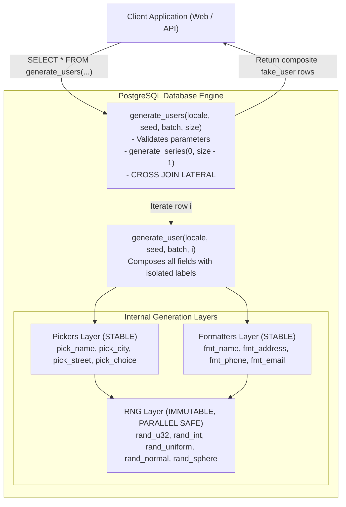

# Stored Procedures Reference: Faker in SQL

A fake data generation library implemented inside PostgreSQL stored routines.

All generation logic executes directly in the database engine. Client applications issue standard SQL queries against these routines to receive structured records.

---

## Table of Contents

1. [Architecture and Design](#architecture-and-design)
2. [Quick Start: Using Faker in SQL](#quick-start)
3. [Core Generation Algorithms](#core-algorithms)
   - [3.1 Pseudo-Random Generation (PRNG)](#prng)
   - [3.2 Normal Distributions (Box-Muller)](#box-muller)
   - [3.3 Geographic Coordinates (Equal-Area)](#coordinates)
   - [3.4 Weighted Categorical Choice](#weighted-choice)
   - [3.5 Name and Address Composition](#name-and-address)
   - [3.6 Markov Text Synthesis](#markov-text)
4. [Database Schema](#schema)
5. [Routine Reference: RNG Layer (010_rng.sql)](#rng-layer)
   - [rand_u32](#rand_u32)
   - [rand_int](#rand_int)
   - [rand_uniform](#rand_uniform)
   - [rand_normal](#rand_normal)
   - [rand_sphere](#rand_sphere)
6. [Routine Reference: Pickers Layer (020_pickers.sql)](#pickers-layer)
   - [pick_name](#pick_name)
   - [pick_city](#pick_city)
   - [pick_street](#pick_street)
   - [pick_choice](#pick_choice)
   - [get_body_params](#get_body_params)
7. [Routine Reference: Formatters Layer (030_formatters.sql)](#formatters-layer)
   - [apply_translit](#apply_translit)
   - [fmt_name](#fmt_name)
   - [fmt_address](#fmt_address)
   - [fmt_phone](#fmt_phone)
   - [fmt_email](#fmt_email)
8. [Routine Reference: Composer Layer (040_composer.sql)](#composer-layer)
   - [generate_user](#generate_user)
9. [Routine Reference: Public API Layer (050_api.sql)](#api-layer)
   - [list_locales](#list_locales)
   - [generate_users](#generate_users)
   - [generate_text](#generate_text)
10. [How to Add a New Locale](#add-locale)
11. [Immutability and Determinism Guarantees](#immutability)

---

<a id="architecture-and-design"></a>
## 1. Architecture and Design

Traditional fake-data generators run in memory on client application servers and insert generated rows one by one. This causes network round-trip overhead and serialization delays.

Faker in SQL moves the generator into PostgreSQL:
- Zero ORM: The application issues a SELECT query and receives structured, pre-formatted records.
- Deterministic Output: A state vector $(s, \text{locale}, b, i, f)$ maps to an identical output row across calls.
- Set-Based Execution: Uses PostgreSQL generate_series and LATERAL subqueries for efficient batch row composition.



---

<a id="quick-start"></a>
## 2. Quick Start: Using Faker in SQL

Once SQL files are applied to the PostgreSQL database, all routines can be queried directly:

### Generating a Batch of Users
```sql
SELECT * FROM generate_users('en_US', 42, 0, 10)
```
```sql
SELECT * FROM generate_users('de_DE', 999, 5, 50)
```

### Seeding an Application Table Directly in SQL
```sql
INSERT INTO customers (full_name, email, phone, city, latitude, longitude)
SELECT 
    full_name,
    email,
    phone,
    split_part(address, ',', 2),
    latitude,
    longitude
FROM generate_series(0, 19) AS b(batch_no)
CROSS JOIN LATERAL generate_users('en_US', 12345, b.batch_no, 50)
```

### Generating Individual Attributes
```sql
SELECT * FROM generate_user('en_US', 42, 0, 0)
```
```sql
SELECT rand_normal(42, 'en_US', 0, 0, 'height', 178.0, 7.5)
```
```sql
SELECT * FROM rand_sphere(42, 'en_US', 0, 0, 'geo')
```
```sql
SELECT generate_text('de_DE', 42, 0, 0, 60)
```

---

<a id="core-algorithms"></a>
## 3. Core Generation Algorithms

<a id="prng"></a>
### 3.1 Pseudo-Random Generation (PRNG)

PostgreSQL built-in `random()` is session-dependent and not reproducible across separate queries.

To guarantee determinism, `rand_u32` computes values from a hash of five parameters:

$$\text{Key} = \text{seed} : \text{locale} : \text{batch} : i : \text{field}$$

- The field label isolates draws so each attribute (first name, coordinates, phone digits) samples an independent hash space.
- The MD5 digest is converted into an unsigned 32-bit integer in $[0, 2^{32} - 1]$.
- Identical parameters always return the exact same number.

---

<a id="box-muller"></a>
### 3.2 Normal Distributions (Box-Muller)

Human heights and weights follow bell curves rather than flat uniform distributions.

The Box-Muller method transforms two independent uniform numbers $U_1, U_2 \in (0, 1)$ into a standard normal score:

$$Z = \sqrt{-2 \ln(U_1)} \cos(2\pi U_2)$$

The score is then shifted by the average and scaled by the standard deviation:

$$X = \mu + \sigma Z$$

Values are kept within realistic biological boundaries defined in `body_params`.

---

<a id="coordinates"></a>
### 3.3 Geographic Coordinates (Equal-Area)

Sampling latitude uniformly between -90 and 90 causes points to cluster heavily around the poles because the circumference of the globe shrinks towards the poles.

To spread locations evenly across the globe surface, latitude is selected by taking the inverse sine of a uniform value:

$$\text{lat} = \arcsin(2U_1 - 1)$$
$$\text{lon} = 360 U_2 - 180$$

This produces equal area probability across the entire sphere.

---

<a id="weighted-choice"></a>
### 3.4 Weighted Categorical Choice

Categorical traits (such as eye colors or honorific titles) appear with unequal frequencies in populations.

The `choices` table stores items with numeric weights. Routine `pick_choice` computes cumulative sums using `SUM(weight) OVER (ORDER BY ord)` and selects the option matching a pseudo-random threshold.

---

<a id="name-and-address"></a>
### 3.5 Name and Address Composition

- Geographic Alignment: Routine `pick_city` bundles city name, state or region, valid postal code bounds, and telephone area code in one record. This keeps addresses and phone numbers geographically consistent.
- Localized Templates: Names and addresses are assembled through templates matching local standards.
- Transliteration: Accented characters and umlauts are converted to ASCII equivalents via the `translit` table to build clean email addresses.

---

<a id="markov-text"></a>
### 3.6 Markov Text Synthesis

Natural text is generated using a bigram Markov chain stored in the `markov` table:
1. Generation begins at a start token pair to choose the initial capitalized word.
2. Subsequent words are picked based on recorded transition weights from the previous two words.
3. When reaching sentence ends, punctuation is completed and the next sentence begins cleanly.

---

<a id="schema"></a>
## 4. Database Schema

```mermaid
erDiagram
    locales ||--o{ names : has
    locales ||--o{ streets : has
    locales ||--o{ cities : has
    locales ||--o{ choices : has
    locales ||--o{ body_params : has
    locales ||--o{ translit : has
    locales ||--o{ pool_sizes : tracks
    locales ||--o{ markov : texts

    locales {
        text code PK "e.g. en_US, de_DE"
        text display_name "Display string"
        text country_name "Country name"
    }

    names {
        text locale PK,FK
        text kind PK "first_male, first_female, last"
        int idx PK "1-based contiguous index"
        text value "Name string"
    }

    streets {
        text locale PK,FK
        int idx PK "1-based contiguous index"
        text name "Base street name"
    }

    cities {
        text locale PK,FK
        int idx PK "1-based contiguous index"
        text city "City name"
        text region "State or region"
        int postal_min "Min postal code"
        int postal_max "Max postal code"
        text area_code "Phone area code"
    }

    choices {
        text locale PK,FK
        text category PK "Category code"
        int ord PK "Order index"
        text value "Option value"
        numeric weight "Relative weight"
    }

    body_params {
        text locale PK,FK
        text gender PK "male or female"
        text attribute PK "height_cm or weight_kg"
        float8 mean "Average"
        float8 sd "Standard deviation"
        float8 min_val "Minimum clamp"
        float8 max_val "Maximum clamp"
    }

    pool_sizes {
        text locale PK,FK
        text pool PK "Pool identifier"
        int size "Row count"
    }

    translit {
        text locale PK,FK
        text from_str PK "Source character"
        text to_str "Target ASCII text"
    }

    markov {
        text locale PK,FK
        text w1 PK "First word"
        text w2 PK "Second word"
        text next_word PK "Next word"
        int weight "Frequency weight"
    }
```



---

<a id="rng-layer"></a>
## 5. Routine Reference: RNG Layer

Routines in `sql/010_rng.sql` are pure functions: marked `IMMUTABLE STRICT PARALLEL SAFE`.

<a id="rand_u32"></a>
### rand_u32
Generates an unsigned 32-bit integer in $[0, 2^{32} - 1]$.

```sql
FUNCTION rand_u32(
    p_seed   bigint,
    p_locale text,
    p_batch  int,
    p_i      int,
    p_field  text
) RETURNS bigint
```

| Parameter | Type | Range | Description |
| :--- | :--- | :--- | :--- |
| `p_seed` | `bigint` | >= 0 | Seed value |
| `p_locale` | `text` | non-null | Locale identifier |
| `p_batch` | `int` | >= 0 | Batch index |
| `p_i` | `int` | >= 0 | Item index |
| `p_field` | `text` | non-null | Field label |

Example:
```sql
SELECT rand_u32(42, 'en_US', 0, 0, 'first_name')
```

---

<a id="rand_int"></a>
### rand_int
Generates an integer in $[0, n - 1]$.

```sql
FUNCTION rand_int(
    p_seed   bigint,
    p_locale text,
    p_batch  int,
    p_i      int,
    p_field  text,
    p_n      int
) RETURNS int
```

Example:
```sql
SELECT rand_int(42, 'en_US', 0, 0, 'die_roll', 6)
```

---

<a id="rand_uniform"></a>
### rand_uniform
Generates a continuous uniform float strictly between 0 and 1.

```sql
FUNCTION rand_uniform(
    p_seed   bigint,
    p_locale text,
    p_batch  int,
    p_i      int,
    p_field  text
) RETURNS float8
```

$$U = \frac{\text{rand\_u32} + 0.5}{2^{32}}$$

---

<a id="rand_normal"></a>
### rand_normal
Generates a normally distributed float with mean and standard deviation.

```sql
FUNCTION rand_normal(
    p_seed   bigint,
    p_locale text,
    p_batch  int,
    p_i      int,
    p_field  text,
    p_mean   float8,
    p_sd     float8
) RETURNS float8
```

Example:
```sql
SELECT rand_normal(42, 'en_US', 0, 0, 'height', 178.0, 7.5)
```

---

<a id="rand_sphere"></a>
### rand_sphere
Generates latitude and longitude evenly across a sphere.

```sql
FUNCTION rand_sphere(
    p_seed   bigint,
    p_locale text,
    p_batch  int,
    p_i      int,
    p_field  text
) RETURNS TABLE(lat float8, lon float8)
```

Returns:
- `lat`: $[-90.0, 90.0]$ with equal area coverage
- `lon`: $[-180.0, 180.0]$

Example:
```sql
SELECT * FROM rand_sphere(42, 'en_US', 0, 0, 'geo')
```

---

<a id="pickers-layer"></a>
## 6. Routine Reference: Pickers Layer

Routines in `sql/020_pickers.sql` retrieve records from lookup tables (`STABLE STRICT PARALLEL SAFE`).

<a id="pick_name"></a>
### pick_name
```sql
FUNCTION pick_name(
    p_locale text,
    p_kind   text,
    p_seed   bigint,
    p_batch  int,
    p_i      int,
    p_field  text
) RETURNS text
```
Fetches name matching the index computed against `pool_sizes`.

---

<a id="pick_city"></a>
### pick_city
```sql
FUNCTION pick_city(
    p_locale text,
    p_seed   bigint,
    p_batch  int,
    p_i      int,
    p_field  text
) RETURNS TABLE(
    city       text,
    region     text,
    postal_min int,
    postal_max int,
    area_code  text
)
```
Retrieves a city record with associated region, postal bounds, and area code.

---

<a id="pick_street"></a>
### pick_street
```sql
FUNCTION pick_street(
    p_locale text,
    p_seed   bigint,
    p_batch  int,
    p_i      int,
    p_field  text
) RETURNS text
```
Picks a base street name from the `streets` table.

---

<a id="pick_choice"></a>
### pick_choice
```sql
FUNCTION pick_choice(
    p_locale   text,
    p_category text,
    p_seed     bigint,
    p_batch    int,
    p_i        int,
    p_field    text
) RETURNS text
```
Selects an option proportionally based on weights in the `choices` table.

---

<a id="get_body_params"></a>
### get_body_params
```sql
FUNCTION get_body_params(
    p_locale    text,
    p_attribute text
) RETURNS TABLE(
    male_mean    float8,
    male_sd      float8,
    male_min     float8,
    male_max     float8,
    female_mean  float8,
    female_sd    float8,
    female_min   float8,
    female_max   float8
)
```
Fetches distribution parameters and bounds for height or weight.

---

<a id="formatters-layer"></a>
## 7. Routine Reference: Formatters Layer

Routines in `sql/030_formatters.sql` perform string formatting and transliteration.

<a id="apply_translit"></a>
### apply_translit
```sql
FUNCTION apply_translit(p_locale text, p_str text) RETURNS text
```
Replaces non-ASCII characters according to the locale transliteration table.

---

<a id="fmt_name"></a>
### fmt_name
```sql
FUNCTION fmt_name(
    p_title    text,
    p_first    text,
    p_middle   text,
    p_last     text,
    p_template text
) RETURNS text
```
Fills name tokens into the template and cleans spaces.

---

<a id="fmt_address"></a>
### fmt_address
```sql
FUNCTION fmt_address(
    p_house_num text,
    p_street    text,
    p_unit      text,
    p_city      text,
    p_region    text,
    p_postal    text,
    p_template  text
) RETURNS text
```
Interpolates address tokens into the selected format template.

---

<a id="fmt_phone"></a>
### fmt_phone
```sql
FUNCTION fmt_phone(
    p_template text,
    p_area     text,
    p_seed     bigint,
    p_locale   text,
    p_batch    int,
    p_i        int,
    p_field    text
) RETURNS text
```
Inserts the area code and replaces each hash symbol with a deterministic random digit.

---

<a id="fmt_email"></a>
### fmt_email
```sql
FUNCTION fmt_email(
    p_first     text,
    p_last      text,
    p_separator text,
    p_num_str   text,
    p_domain    text,
    p_locale    text
) RETURNS text
```
Constructs an email address from transliterated name parts, separator, suffix, and domain.

---

<a id="composer-layer"></a>
## 8. Routine Reference: Composer Layer

<a id="generate_user"></a>
### generate_user
Assembles all field routines into a single complete user record.

```sql
FUNCTION generate_user(
    p_locale text,
    p_seed   bigint,
    p_batch  int,
    p_i      int
) RETURNS fake_user
```

Composite Type Schema (`fake_user`):
```sql
CREATE TYPE fake_user AS (
    full_name text,
    address   text,
    latitude  float8,
    longitude float8,
    height_cm numeric,
    weight_kg numeric,
    eye_color text,
    phone     text,
    email     text
)
```

Example:
```sql
SELECT * FROM generate_user('en_US', 42, 0, 0)
```

---

<a id="api-layer"></a>
## 9. Routine Reference: Public API Layer

Public entry points in `sql/050_api.sql`.

<a id="list_locales"></a>
### list_locales
```sql
FUNCTION list_locales() RETURNS TABLE(code text, display_name text)
```
Returns active locales ordered by display name.

---

<a id="generate_users"></a>
### generate_users
Generates a table batch of synthetic users with parameter validation.

```sql
FUNCTION generate_users(
    p_locale text,
    p_seed   bigint,
    p_batch  int,
    p_size   int DEFAULT 10
) RETURNS TABLE (
    batch_no  int,
    idx       int,
    full_name text,
    address   text,
    latitude  float8,
    longitude float8,
    height_cm numeric,
    weight_kg numeric,
    eye_color text,
    phone     text,
    email     text
)
```

Validation Rules (raises error code 22023 on failure):
- Locale must exist in the `locales` table
- Seed must be between 0 and 2147483647
- Batch must be between 0 and 10000
- Size must be between 1 and 50

Example:
```sql
SELECT idx, full_name, email, phone FROM generate_users('en_US', 1234, 0, 5)
```

---

<a id="generate_text"></a>
### generate_text
Synthesizes natural text paragraphs using a bigram Markov chain.

```sql
FUNCTION generate_text(
    p_locale  text,
    p_seed    bigint,
    p_batch   int,
    p_i       int,
    p_n_words int DEFAULT 60
) RETURNS text
```

Parameters:
- `p_locale`: Language code (`en_US` or `de_DE`)
- `p_seed`, `p_batch`, `p_i`: State coordinates
- `p_n_words`: Target word count between 10 and 500

Example:
```sql
SELECT generate_text('en_US', 42, 0, 0, 60)
```

---

<a id="add-locale"></a>
## 10. How to Add a New Locale

1. Register Locale:
   ```sql
   INSERT INTO locales (code, display_name, country_name)
   VALUES ('fr_FR', 'Français (France)', 'France')
   ```
2. Populate Names:
   Insert male first names, female first names, and surnames with contiguous 1-based indices.
3. Populate Streets and Cities:
   Insert street names and cities with postal bounds and area codes.
4. Populate Choices:
   Add rows for titles, name templates, address templates, street types, phone templates, domains, and eye colors.
5. Set Physical Parameters:
   Define distribution averages and bounds for height and weight in `body_params`.
6. Set Transliteration:
   Map non-ASCII characters to ASCII in `translit`.
7. Update Pool Sizes:
   Insert row counts for each pool into `pool_sizes`.
8. Verify Integrity:
   Run `python scripts/check_data.py` to confirm index continuity and constraint validity.

---

<a id="immutability"></a>
## 11. Immutability and Determinism Guarantees

Because modulo indexing maps to 1-based table indices:
- Lookup tables must remain append-only and immutable once tests are established.
- Calling `generate_users('en_US', seed, batch, size)` on any machine or at any point in time will generate the exact same identities in the exact same sequence.
